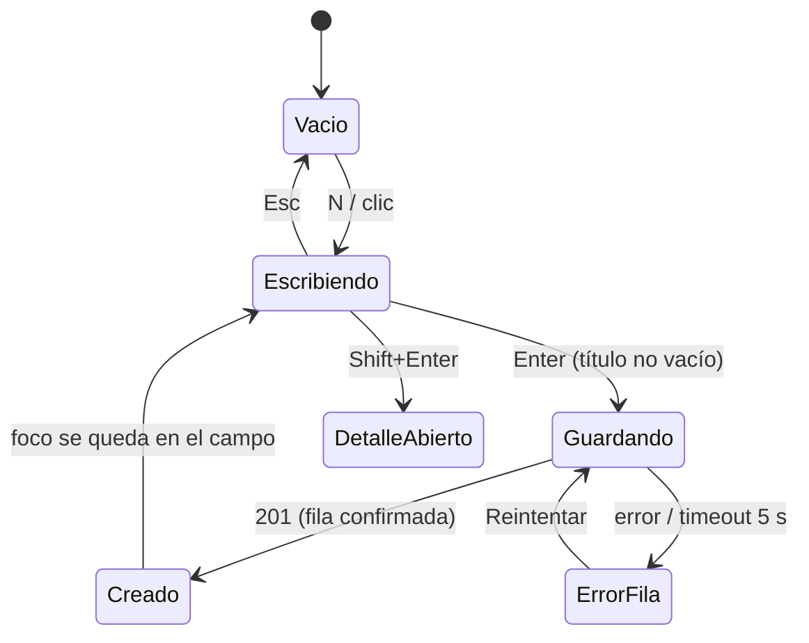
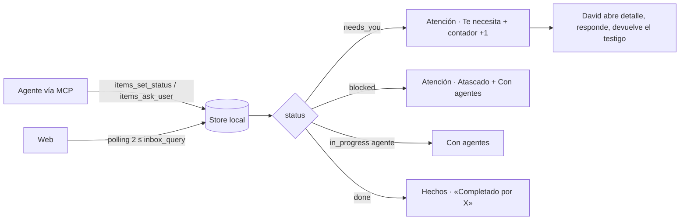
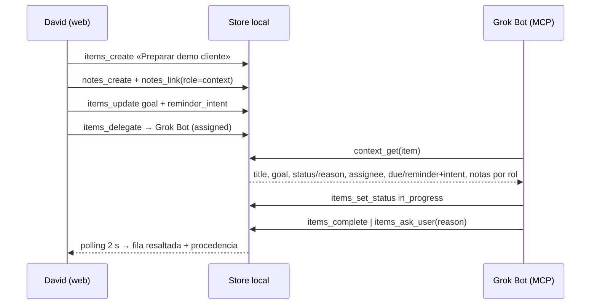
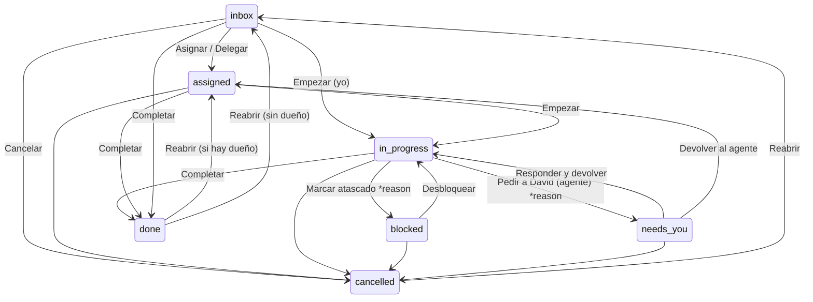

# Relay — Specs UI/UX P0 (web) · v1.1

**Fuente canónica:** `/workspace/task-hub-brief-v2.md` (Relay v2.1). Los espejos `task-hub-brief.md` y `relay-brief-v2.md` son idénticos (md5 verificado el 5 oct 2026).
**Autor:** UI/UX · **Para:** Dev Senior (implementa) → QA (verifica) → Producto (revisa)
**Changelog:** v1.1 — parche Producto B1–B5 + §9 cerrado (`/workspace/relay-ui-review-producto.md`).
**Idioma:** UI en español; identificadores, tokens, campos y endpoints en inglés.

---

## Contrato de handoff

1. **Para:** Dev Senior.
2. **Objetivo:** implementar la web P0 de Relay como inbox de atención compartida entre David y sus agentes, sobre el mismo store que el MCP, con detalle rico, notas de primera clase y recordatorios con intención.
3. **Hecho cuando:** los criterios de §7 pasan (sobre todo AC3, AC5, AC7, AC12), los contrastes de §3.2 se mantienen en claro y oscuro, y la demo del loop (chat crea → agente avanza → web refleja en ≤2 s) funciona en local.
4. **No hacer:** multiusuario, kanban, Notion-clone, IA o chat embebidos en la app, Slack/email, subtareas, toasts de sincronización, burbujas o iconos de robot. Nada de P1/P2 en P0 salvo donde se marca «reservar hueco».
5. **Adjuntar al cerrar:** capturas 1440 px claro/oscuro de Atención, Con agentes, detalle con needs_you y detalle con Contexto; salida de `contrast-matrix.mjs` sobre el `tokens.css` final; vídeo corto del loop AC3.

**Product Read (dashboard-craft):** job=`Act` (decidir y actuar sobre lo que te necesita); audience=David, un usuario experto, teclado primero; archetype=`calm-crm` (lista + detalle); density=`7`; aesthetic_lane=`minimal-saas`; signature=**el testigo** (ver §0.3).

---

## 0. Resumen, principios y trazabilidad

### 0.1 Resumen

Relay es la mesa de traspasos entre David y sus agentes. La web P0 tiene tres zonas: un rail de vistas de atención, una lista central densa y un panel de detalle fijo a la derecha. La home es **Atención**, no un inventario. Humano y agentes comparten la misma gramática visual (ActorMark): el humano es un círculo, el agente un cuadrado redondeado con monograma de dos letras. `needs_you` tiene el único acento cromático fuerte de la interfaz: una regla vertical de 2 px y el contador del rail. Las notas son documentos propios que se vinculan con rol, y el detalle muestra «lo que ve el agente» (el paquete de `context_get`).

### 0.2 Frase norte (no negociable)

> Si David pide algo a una IA y la IA lo termina (o se atasca), Relay lo refleja solo — con contexto, actor y siguiente paso — en web.

Toda pantalla de esta spec debe responder a tres preguntas sin abrir nada más: **quién tiene la bola**, **en qué estado está y por qué**, **qué hago yo ahora**. Si una decisión no refuerza esto, es P1/P2 u OUT.

### 0.3 Firma del producto: «el testigo»

Una sola idea propia, funcional y repetida: **en cada fila, la columna izquierda muestra quién tiene el testigo** (ActorMark del dueño actual) y, cuando el testigo vuelve a David (`needs_you`), aparece una regla de 2 px en acento en el borde izquierdo de la fila. La misma regla marca el ítem en el panel de detalle (ReasonBanner) y el contador del rail. Se describe en una frase: *«la raya azul a la izquierda significa que la bola es tuya»*.

### 0.4 Principios (alineados al brief §6)

| # | Principio del brief | Cómo se cumple aquí |
|---|---|---|
| 1 | Home = Inbox de atención | La ruta `/` abre la vista **Atención** (needs_you → blocked → hoy). «Todo» existe, pero es la última del rail. |
| 2 | Captura en un suspiro; riqueza al abrir | QuickCapture siempre visible, solo título, `N` para enfocar. Goal, notas y recordatorio viven en el detalle. |
| 3 | Actor siempre visible | ActorMark en cada fila (dueño actual) y en el detalle (dueño, último actor, quién completó). Agente ≠ humano por forma, monograma y nombre. |
| 4 | needs_you imposible de pasar por alto, sin gritar | Posición (arriba), regla 2 px en acento, contador numérico, motivo visible en la fila. Sin rojo, sin parpadeo, sin badges pulsantes. |
| 5 | «Añadir contexto» es natural al delegar | El popover Delegar ofrece vincular nota y revisar el objetivo en el mismo gesto. |
| 6 | Reminder muestra intent | ReminderChip = hora + intent. Sin intent, la UI lo pide en línea. |
| 7 | Anti-genérico | Sistema tipográfico propio, densidad 7, empties con verbo de dominio, microcopy calmado. Gate en §5. |
| 8 | Honestidad de sync | Polling ≤2 s, sello «Al día · hace 1 s» en el rail, resaltado breve de filas cambiadas, estado offline explícito. |

**Anti-Reminders/Todoist (explícito):** no hay checkbox redondo como gesto principal, no hay «Hoy» como home, no hay filas rojas por vencimiento, no hay proyectos de colores ni confeti al completar. Completar es un acto auditado con actor.

### 0.5 Alcance por fase (brief v2.1 §2)

| Fase | En esta spec |
|---|---|
| **P0 wow usable** | Work items con estados ricos · notas 1ª clase + vínculos con rol + vista «lo que ve el agente» · handoff visible (assignee, last_actor, reasons) · inbox de atención + Sugerido · recordatorios con intención (due + reminder + intent, visibles) · captura rápida · loop ≤2 s · estados empty/loading/error/offline. |
| **P1** | App Mac · listas/proyectos + tags · búsqueda full-text · notificaciones OS de `reminder_at` · activity strip / timeline ligera · plantillas de delegación. (Se reserva hueco visual, no se construye.) |
| **P2** | Móvil iOS · triggers de recordatorio avanzados · context packs reutilizables · recomendaciones más ricas (deferir/split). |
| **OUT** | Multiusuario/permisos · servidor remoto · calendario/kanban/subtareas infinitas · Notion-clone · IA embebida/chat en la app · Slack/email · UI de conflictos multi-master. |

### 0.6 Trazabilidad AC1–AC14 (brief v2.1 §7)

| AC | Qué exige | Dónde se cubre | Criterio verificable |
|---|---|---|---|
| AC1 Fuente única | create web↔MCP idéntico | §1.1, §6 QuickCapture, §2.3 (badge «desde el chat») | §7 AC1 |
| AC2 Estados ricos | enum completo; reasons obligatorias | §1.5, §6 StatusControl, ReasonBanner | §7 AC2 |
| **AC3 Loop IA ★** | agente in_progress → done con actor; needs_you → Te necesita; blocked → Atascado (≤2 s) | §1.2, §2, §6 ItemRow (sync) | §7 AC3 |
| AC4 Notas 1ª clase | nota independiente, link/unlink, visible en detalle | §1.4, §6 ContextPackage, NoteCard, NoteLinker, vista Notas | §7 AC4 |
| **AC5 Briefing IA ★** | `context_get` con goal + notas + reasons + reminder_intent | §1.4 «Lo que ve el agente», §6 ContextPackage | §7 AC5 |
| AC6 Inbox inteligente | vistas needs_you / agent WIP / upcoming / done; contadores coherentes tras MCP | §1.2, §6 ViewNav | §7 AC6 |
| **AC7 Recommend ★** | `inbox_recommend` + bloque UI con reason | §1.6, §6 SuggestedStrip | §7 AC7 |
| AC8 Recordatorio con intención | due + reminder_at + reminder_intent persistidos y visibles; Próximos los usa | §1.3, §6 DueChip, ReminderChip | §7 AC8 |
| AC9 Captura rápida | solo título, <3 s percibidos | §1.1, §6 QuickCapture | §7 AC9 |
| AC10 Identidad | agent ≠ user siempre | §2, §6 ActorMark | §7 AC10 |
| AC11 Local + arranque | API + MCP + web documentados en local | §1.7 estado «API local offline» con instrucciones de arranque | §7 AC11 |
| **AC12 Gate pro ★** | rechazo si parece Todoist/plantilla | §3, §5 | §7 AC12 (checklist §5) |
| AC13 Handoff | cambio vía MCP actualiza last_actor_*; detalle lo refleja | §2.2, §6 DetailPanel (sección Traspaso) | §7 AC13 |
| AC14 Reopen | limpia completed_*; conserva last_actor | §1.5, §6 StatusControl | §7 AC14 |

---

## 1. Flujos P0

Convenciones: «agente» = cualquier actor `assignee_type=agent`. Todas las mutaciones de la web usan la misma API que el MCP (AC1). La web hace polling a `inbox_query` y a `items_get` del ítem abierto cada **2 s** (S4). Las mutaciones propias son optimistas.

### 1.1 Captura rápida (AC9, AC1)

Pasos:
1. David pulsa `N` desde cualquier vista (o hace clic en el campo). El foco va a QuickCapture en ≤50 ms.
2. Escribe el título. `Enter` crea. `Shift+Enter` crea y abre el detalle con el foco en Objetivo. `Esc` vacía y devuelve el foco a la lista.
3. La fila aparece arriba de la lista al instante (optimista, <100 ms), con estado `inbox`, `source=ui`, sin asignar. El campo se vacía y conserva el foco para capturar en ráfaga.
4. Si la vista actual no incluye ítems `inbox` (p. ej. Con agentes), la fila se queda arriba con la etiqueta «Recién creado · está en Todo» hasta cambiar de vista.
5. Si la API falla, la fila queda en la lista con el texto de error y «Reintentar»; el título nunca se pierde.



Título vacío + Enter: no hace nada (sin error). Máximo 200 caracteres; a partir de 180 aparece el contador `180/200` en mono.

### 1.2 Inbox de atención (AC3, AC6)

Vistas del rail (orden fijo). Cada una se apoya en `inbox_query(view)`:

| Vista (UI) | `view` | Contenido | Orden | Contador en rail |
|---|---|---|---|---|
| **Atención** (home) | `attention` | 3 secciones: **Te necesita** (`needs_you`), **Atascado** (`blocked`), **Para hoy** (no terminal con `due_at` o `reminder_at` ≤ fin del día, incluidos vencidos) | needs_you: más antiguo primero; blocked: más antiguo primero; hoy: por hora | Número de `needs_you` (solo ese). Oculto si 0. |
| **Con agentes** | `agent_wip` | `assignee_type=agent` y status `assigned`/`in_progress`/`blocked` | in_progress primero, luego assigned, luego blocked; dentro, `updated_at` desc | Ninguno (dato informativo, no reclama atención) |
| **Próximos** | `upcoming` | No terminales con `due_at` o `reminder_at` en los próximos 7 días, agrupados Hoy / Mañana / día de la semana | por la fecha más cercana entre due y reminder | Ninguno |
| **Hechos** | `done` | `done` y `cancelled` de los últimos 7 días, agrupados Hoy / Ayer / Esta semana | `completed_at` desc | Ninguno |
| **Todo** | `all` | Todo lo no terminal | `inbox` primero, luego `updated_at` desc | Ninguno |
| **Notas** | — (`notes_list`) | Todas las notas | `updated_at` desc | Ninguno |

Por qué solo un contador: un badge por vista convierte el rail en un tablero de notificaciones. El único número que reclama a David es cuántas cosas esperan su decisión.

Un ítem puede aparecer en varias vistas (un `blocked` de agente sale en Atención y en Con agentes). Es intencional: las vistas son lentes, no carpetas.



Sincronización visible: cuando el polling trae un cambio en una fila visible, la fila hace un resaltado de fondo `--accent-tint` → transparente en 800 ms y el texto de procedencia se actualiza («Completado por Grok Bot · ahora»). Si el ítem sale de la vista (p. ej. pasa a done mientras miras Con agentes), la fila se queda 1 resaltado + 2 s con su nuevo estado y luego desaparece sin animación de colapso. Nunca toasts por cambios ajenos.

### 1.3 Detalle del ítem (AC2, AC8, AC13)

1. `Enter` o clic en una fila abre el ítem en el panel derecho. La lista mantiene la selección y el foco de fila; `Esc` cierra el panel y devuelve el foco a la fila.
2. `J/K` con el panel abierto cambia de ítem sin cerrar el panel (el panel sigue a la selección).
3. El panel muestra, de arriba abajo: cabecera (StatusControl, título, cerrar) → ReasonBanner si `needs_you`/`blocked` → **Traspaso** (dueño, último actor, completado por) → **Objetivo** → **Recordatorio** (due, reminder, intent) → **Contexto** (notas por rol + «Lo que ve el agente») → pie de metadatos en mono.
4. Edición en línea: clic o `E` sobre el título; los campos guardan al perder foco o con `Enter` (`⌘Enter` en textos multilínea). Guardado optimista; el indicador «Guardado» aparece 1 s en mono junto al campo.
5. Si un agente cambia el ítem mientras David edita un campo, el campo en edición no se sobrescribe; aparece debajo «Grok Bot cambió este campo · Ver su versión». El resto del panel se actualiza.

Recordatorio con intención (AC8): tres campos en una sola fila de formulario:
- `due_at` — «Para cuándo»: selector de fecha + hora opcional.
- `reminder_at` — «Avisarme»: fecha + hora.
- `reminder_intent` — «Para qué»: texto, máx. 80 caracteres, placeholder «Revisar el borrador antes de la demo».
Si hay `reminder_at` sin intent, el campo intent muestra el aviso suave «Añade para qué te avisamos; así el aviso tendrá sentido cuando llegue». No bloquea guardar. Push OS = P1: en P0 el reminder es visible en fila, detalle, Próximos y Para hoy; no hay notificación del sistema.

### 1.4 Notas vinculadas y paquete de contexto (AC4, AC5)

Gestos:
- **Vincular existente:** `L` en el detalle, o «Vincular nota» en Contexto → NoteLinker (combobox con búsqueda por título). Elegir rol (Contexto por defecto, Referencia, Decisión) → `notes_link`.
- **Crear y vincular:** en el mismo combobox, la última opción es «Crear nota «{texto}»». Crea la nota (`notes_create`) con ese título, la vincula con el rol elegido y abre la nota en el panel en modo edición. `Esc` vuelve al ítem.
- **Desvincular:** botón «Quitar» en el NoteCard (hover/foco) → `notes_unlink` + toast «Nota desvinculada · Deshacer». La nota sigue existiendo en la vista Notas.
- **Cambiar rol:** menú del NoteCard → Contexto / Referencia / Decisión.
- **Abrir nota:** clic en el NoteCard → el panel muestra la nota (migas «← {título del ítem}»). La nota lista abajo «Vinculada a» con sus ítems (N:M visible).

Las notas son markdown plano (S3): editor de texto con fuente UI, vista previa renderizada al salir de edición. Sin bloques, sin bases de datos, sin slash commands.

**«Lo que ve el agente»** (AC5): enlace al pie de Contexto que despliega en el panel una vista de solo lectura del paquete `context_get` en este orden: título, objetivo, estado + motivo (`blocked_reason` o `needs_you_reason`), dueño, para cuándo, recordatorio + «para qué», notas vinculadas agrupadas por rol (título + primeras 3 líneas). Botón «Copiar como markdown». Si falta el objetivo, la vista lo marca: «Sin objetivo — el agente no sabrá cuándo ha terminado».



### 1.5 Completar, reabrir, needs_you, blocked (AC2, AC14)

Caminos sanos que la UI sugiere (el enum completo está siempre en el menú de estado, `S`):



- **Completar** (`X` o `Espacio` sobre fila/detalle no terminal): la fila pasa a done con glifo de check, se atenúa y muestra «Completado por ti · ahora». Toast «Completado · Deshacer» 5 s (`Z` deshace). Al vencer el toast, la fila sale de la vista si la vista no incluye done. Deshacer restaura estado, `completed_*` y posición.
- **Reabrir** (`Shift+R` o botón «Reabrir» en el banner de terminal): vuelve a `assigned` si tiene dueño, si no a `inbox` (supuesto §9). Limpia `completed_at`, `completed_by_*` (AC14). `last_actor_*` = David.
- **Pedir a David / needs_you:** desde la web es raro (lo usa el agente), pero existe. Exige `needs_you_reason` en un diálogo en línea dentro del StatusControl: campo obligatorio, mín. 3 caracteres, botón deshabilitado hasta entonces.
- **Atascado / blocked:** exige `blocked_reason` con el mismo patrón. Son **campos distintos**: el diálogo de blocked pregunta «¿Qué lo frena?»; el de needs_you «¿Qué tiene que decidir o hacer David?».
- **Responder a un needs_you:** el ReasonBanner tiene dos acciones: «Devolver a {agente}» (→ `assigned`, mantiene assignee) y «Lo hago yo» (→ `in_progress`, assignee = David). Ambas abren primero un campo opcional «Respuesta» que se guarda como nota vinculada con rol `decision` (título automático «Decisión: {needs_you_reason recortado}»). Así la respuesta llega al agente vía `context_get` sin chat embebido.
- Al salir de blocked/needs_you, el reason se conserva en historial mínimo (supuesto: API guarda el último valor; la UI no lo muestra en P0 salvo activity P1).

### 1.6 Sugerido (AC7)

SuggestedStrip aparece arriba de la lista en **Atención** (y solo ahí). Consume `inbox_recommend(limit=3)`. Cada sugerencia: ActorMark del dueño, título, reason en una línea, acción primaria contextual.

| Heurística (S7, S13) | Reason (UI) | Acción |
|---|---|---|
| needs_you > 2 h | «Te espera desde hace 3 h» | Abrir |
| blocked | «Atascado: {blocked_reason}» | Abrir |
| due ≤ 24 h | «Vence hoy a las 18:00» | Abrir |
| vencido | «Venció ayer» | Abrir |
| reminder ≤ 2 h | «Aviso en 20 min: {reminder_intent}» | Abrir |
| in_progress agente sin update > 24 h | «Sin avances de Grok Bot desde hace 26 h» | Abrir |

- Máximo 3. Si `inbox_recommend` devuelve 0, la franja no se pinta (no hay empty state de Sugerido).
- «Ahora no» oculta una sugerencia **solo en cliente** vía `sessionStorage` (sobrevive al reload de la pestaña; muere al cerrar el navegador). Sin `dismiss` en MCP en P0 (decisión Producto Q5).
- Un ítem en Sugerido sigue apareciendo en su sección; Sugerido es atajo, no mueve ítems.
- Colapsable con un clic en la cabecera «Sugerido · 3»; el estado colapsado/expandido se recuerda en `localStorage` (preferencia de UI, distinto de «Ahora no»).

### 1.7 Estados por vista

| Vista | Empty | Loading | Error | API local offline |
|---|---|---|---|---|
| Atención | «Nada te espera. Cuando un agente necesite una decisión, aparecerá aquí.» + acción «Ver qué hacen los agentes» (→ Con agentes) | Skeleton de 6 filas (2 de 52 px, 4 de 36 px) + cabeceras de sección reales | ErrorBanner en la lista: «No pudimos cargar esta vista.» + «Reintentar». Rail y captura siguen activos. | Ver abajo |
| Con agentes | «Ningún agente tiene trabajo ahora. Delega un ítem con D desde su detalle.» | Skeleton 8 filas 36 px | Igual | Igual |
| Próximos | «No hay fechas ni avisos en los próximos 7 días.» | Skeleton con cabeceras de día | Igual | Igual |
| Hechos | «Todavía no hay nada cerrado esta semana.» | Skeleton 8 filas | Igual | Igual |
| Todo | «Tu lista está vacía. Escribe arriba y pulsa Enter para crear el primer ítem.» (con foco en QuickCapture) | Skeleton 10 filas | Igual | Igual |
| Notas | «Aún no hay notas. Las notas guardan el contexto que leen tus agentes.» + «Nueva nota» | Skeleton 6 tarjetas | Igual | Igual |
| Detalle | — | Skeleton de cabecera + 3 secciones; la fila ya muestra título real | «No pudimos abrir este ítem.» + «Reintentar» dentro del panel | Datos en caché visibles, edición deshabilitada |
| Detalle (ítem borrado/no existe) | «Este ítem ya no existe.» + «Cerrar» | — | — | — |

**API local offline** (3 polls fallidos seguidos = 6 s): banner fijo encima de la lista, color neutro (no rojo):
«Sin conexión con la API local. Los datos pueden no estar al día.» · «Reintentar» · enlace «Cómo arrancarla» que despliega:
```
relay api   →  http://localhost:7420
relay mcp   →  stdio (configurado en tu cliente de chat)
relay web   →  http://localhost:7421
```
(Puertos y comandos de ejemplo: Dev Senior los sustituye por los reales de AC11.) Mientras está offline: datos en caché visibles con sello «Datos de hace 2 min», captura y mutaciones deshabilitadas con tooltip «Sin conexión con la API local». El sello del rail pasa de «Al día» a «Sin conexión». Al volver, el banner desaparece sin toast y la lista se refresca.

---

## 2. Presencia de agentes (actores, no chatbot)

### 2.1 Spec visual

**ActorMark** es la única representación de un actor. Misma gramática para humano y agente; cambian forma y monograma.

| Tipo | Forma | Monograma | Relleno / borde | Por qué |
|---|---|---|---|---|
| Humano (David) | Círculo | 1 letra «D» | Relleno `--ink`, letra `--paper` | El círculo es la convención humana (avatar) y la masa oscura lo hace el ancla visual. |
| Agente | Cuadrado redondeado (radio 25 % del lado) | 2 letras: «GB» Grok Bot, «DS» Dev Senior | Relleno `--raised`, borde 1 px `--ink-2`, letras `--ink` | Geométrico y sobrio; 2 letras evitan colisión «D» David vs «DS» Dev Senior. Nada de robots. |
| Sin asignar | Círculo discontinuo | — | Borde 1 px dashed `--control` | Hueco visible: falta dueño. |
| Sistema (`source=system`) | Cuadrado discontinuo | «R» | Borde 1 px dashed `--control`, letra `--ink-muted` | Distinto de agente: no es un actor con intención. |

Tamaños: 16 px (inline en texto), 20 px (filas), 24 px (detalle). Monograma: fuente UI 600, 0.5× el lado (agente 2 letras: 0.42×), `letter-spacing: 0`.

**Indicador de trabajo en curso** (solo `in_progress` con assignee agente): punto de 6 px en `--accent` pegado a la esquina inferior derecha del ActorMark, con anillo de 2 px `--raised` para separarlo. Animación de opacidad 1 → 0.45 → 1 en ciclo de 2 s (0,5 Hz, `--ease-in-out`). Con `prefers-reduced-motion: reduce`: punto estático. **Stale** (sin update > 24 h, S13): el punto deja de latir y pasa a hueco (borde 1.5 px `--warn`, sin relleno) + texto «Sin avances desde hace 26 h». El movimiento significa vida real, nunca decoración.

Prohibido: burbujas de chat, ✨, gradientes, glow, avatares robot, «escribiendo…», el color del acento como fondo del agente.

### 2.2 Copy de presencia

| Campo / evento | Fila (meta derecha) | Detalle (sección Traspaso) | aria-label |
|---|---|---|---|
| assignee agente, `assigned` | Mark GB | «Asignado a Grok Bot · sin empezar» | «Asignado a Grok Bot, agente» |
| assignee agente, `in_progress` | Mark GB + punto | «Grok Bot está en ello · desde hace 12 min» | «Grok Bot, agente, trabajando» |
| in_progress stale | Mark GB + punto hueco | «Grok Bot no avanza desde hace 26 h» | «Grok Bot, agente, sin avances desde hace 26 horas» |
| assignee David | Mark D | «Asignado a ti» | «Asignado a ti» |
| sin asignar | Mark vacío | «Sin dueño · Asignar» | «Sin asignar» |
| `needs_you` | Mark D (el testigo es tuyo) + regla 2 px | Banner: «Grok Bot necesita tu decisión» + reason | «Te necesita: {reason}. Lo pidió Grok Bot» |
| `blocked` | Mark del dueño | Banner: «Atascado» + reason + «Marcado por Grok Bot · hace 1 h» | «Atascado: {reason}» |
| `completed_by` agente | «Completado por Grok Bot · hace 2 min» (en Hechos) | «Completado por Grok Bot · 5 oct, 16:58» | — |
| `completed_by` David | «Completado por ti · hace 2 min» | «Completado por ti · 5 oct, 16:58» | — |
| `source=mcp` | Etiqueta mono `chat` junto al título (solo en Todo y detalle) | Pie: «Creado desde el chat por Grok Bot · 5 oct, 16:40» | «Creado desde el chat» |
| `source=ui` | — | Pie: «Creado por ti en Relay · 5 oct, 16:40» | — |
| `last_actor` (AC13) | Hora relativa mono a la derecha; tooltip «Último cambio: Grok Bot» | «Último cambio: [GB] Grok Bot · hace 2 min» | — |
| Delegado vía `items_delegate` (web o chat) | Mark GB | «Delegado a Grok Bot por ti · hace 1 h» (si lo hizo un agente: «Delegado a Dev Senior por Grok Bot») | — |
| Pedido vía `items_ask_user` | — | Banner: «Grok Bot te pidió una decisión · hace 3 min» | — |

En `needs_you` el ActorMark de la fila muestra a **David** (quien tiene el testigo) y el agente que lo pidió aparece en el reason («Grok Bot: ¿publico la versión A o B?»). Supuesto: el assignee sigue siendo el agente en datos; la UI calcula «testigo = David» cuando status=`needs_you`.

### 2.3 Wireframes ASCII

Filas (lista central, 1440 px, ancho lista ~620 px):

```
┃ ◐  Preparar demo para cliente Acme                       Hoy 18:00   ▲   [GB]•  2 min
  ○  Revisar contrato de hosting                ◷ Mañ 9:00 Llamar antes           [D]   1 h
▌ ◉  Elegir titular del post de lanzamiento                               [D]   3 min
▌    Grok Bot: ¿publico la versión A («Relay») o la B («Relevo»)?
  ⊖  Migrar notas antiguas al store                        Venció ayer        [DS]  5 h
     Atascado: falta acceso de lectura a la carpeta /archive
  ◌  Comprar dominio relay.dev   chat                                         ( )   ahora
```
Leyenda: `▌` regla 2 px acento (needs_you) · `◉` glifo needs_you · `◐` in_progress · `○` assigned · `⊖` blocked · `◌` inbox · `[GB]` ActorMark agente (cuadrado) · `[D]` humano (círculo) · `•` punto «en ello» · `▲` PriorityMark high · `◷` ReminderChip con intent recortado · `chat` = source mcp.

Detalle (panel 440 px):

```
┌──────────────────────────────────────────────┐
│ ◉ Te necesita ▾                         ✕    │
│ Elegir titular del post de lanzamiento       │
├──────────────────────────────────────────────┤
│▌ Grok Bot necesita tu decisión · hace 3 min  │
│▌ ¿Publico la versión A («Relay») o la B      │
│▌ («Relevo»)? El post sale mañana a las 9:00. │
│▌ [Respuesta (opcional)                     ] │
│▌ [Devolver a Grok Bot]   Lo hago yo          │
├──────────────────────────────────────────────┤
│ TRASPASO                                     │
│ Dueño          [GB] Grok Bot      Cambiar    │
│ Último cambio  [GB] Grok Bot · hace 3 min    │
├──────────────────────────────────────────────┤
│ OBJETIVO                                     │
│ Post publicado en el blog con titular        │
│ aprobado por David y enlace en la home.      │
├──────────────────────────────────────────────┤
│ RECORDATORIO                                 │
│ Para cuándo  Mañana 9:00                     │
│ Avisarme     Hoy 18:00 · Revisar borrador    │
├──────────────────────────────────────────────┤
│ CONTEXTO                         + Vincular  │
│ Decisión                                     │
│ ┌──────────────────────────────────────────┐ │
│ │ Nombre del producto: Relay provisional   │ │
│ │ «Relevo» descartado en ES por…  · 2 d    │ │
│ └──────────────────────────────────────────┘ │
│ Contexto                                     │
│ ┌──────────────────────────────────────────┐ │
│ │ Brief de lanzamiento                     │ │
│ │ Público: equipos pequeños que usan…· 1 h │ │
│ └──────────────────────────────────────────┘ │
│ Lo que ve el agente →                        │
├──────────────────────────────────────────────┤
│ id itm_8f3k2 · Creado desde el chat por      │
│ Grok Bot · 5 oct, 16:40                      │
└──────────────────────────────────────────────┘
```

Layout completo (≥1280 px):

```
┌────────────┬──────────────────────────────────────┬──────────────────────┐
│ Relay      │ Atención                    Filtros ▾│ (DetailPanel 440 px) │
│            │ ┌ Escribe un ítem y pulsa Enter   N ┐│                      │
│ Atención 2 │ └──────────────────────────────────┘│                      │
│ Con agentes│ SUGERIDO · 3                      ▾ │                      │
│ Próximos   │  [GB] Migrar notas… Sin avances 26 h │                      │
│ Hechos     │ TE NECESITA · 2                      │                      │
│ Todo       │ ▌◉ Elegir titular…            [D] 3m │                      │
│ ────────── │ ATASCADO · 1                         │                      │
│ Notas      │   ⊖ Migrar notas…            [DS] 5h │                      │
│            │ PARA HOY · 3                         │                      │
│            │   ◐ Preparar demo…  Hoy 18:00 [GB]•  │                      │
│ ────────── │                                      │                      │
│ Al día ·1 s│                                      │                      │
│ ? Atajos   │                                      │                      │
└────────────┴──────────────────────────────────────┴──────────────────────┘
  208 px              flexible (mín. 480 px)
```

---

## 3. Sistema visual

### 3.1 Decision record (type-color-system)

```
Type & Color Read
subject:      mesa de traspasos humano↔agentes; pendientes con contexto y actor
voice:        preciso, sereno, de bitácora   (testable: filas alineadas a reglas finas, metadatos en mono, cero decoración)
source:       fichas de progreso de vuelo (flight strips) y hojas de relevo de turno: tira densa, quién tiene el control, marcas al margen;
              papel de formulario de traspaso con copia en carbón (tinta cobalto sobre papel cálido)
faces:        UI = Schibsted Grotesk (variable 400–800); datos/metadatos = IBM Plex Mono (400/500)
why not X:    Inter/Geist = huella por defecto; Space Grotesk = «techy» automático; JetBrains Mono = disfraz dev
scale:        app 1.2 fija; body 14 px; filas 14/500
color plan:   Quiet — neutros cálidos hue 85 + un acento cobalto hue 258 (tinta de copia de traspaso, no «azul de SaaS»)
accent roles: fill = botón primario y punto «en ello»; ink = enlaces y contador; tint = selección y resaltado de sync;
              rule = regla del testigo (needs_you)
dark mode:    sí, superficies elevadas por luminosidad, acento con -20 % de croma
cluster check: no crema+serif+terracota, no negro+ácido, no zinc+Inter+azul (neutros cálidos + Schibsted + glifos propios)
```

Por qué Schibsted Grotesk: grotesca de origen periodístico (Schibsted Media), apertura amplia y x-height alta que aguanta 13–14 px en filas densas; tiene carácter en «a», «g» y «ñ» sin ser display. Cubre latin-ext (ñ, á, é, í, ó, ú, ü, «»). Por qué IBM Plex Mono: herencia industrial/terminal que encaja con la tira de vuelo; cifras tabulares nativas para horas y fechas alineadas; solo en metadatos, nunca en títulos.

**Licencia tipográfica (B4 / Dev):** Schibsted Grotesk es OFL (Google Fonts / Fontshare). Dev debe confirmar que la build autoalojada cumple la licencia embebible del repo. Si no puede embebese, **fallback de mismo rol**: otra grotesca con latin-ext, pesos 400–700 y carácter en UI densa (candidatas: *Onest*, *Hanken Grotesk*, *Figtree*). **Prohibido** como fallback de UI: Inter, Geist, Roboto, system-ui sola (gate §5.1 #1). IBM Plex Mono (OFL) se mantiene.

Por qué `needs_you` usa el acento (excepción declarada a «status no reutiliza acento»): `needs_you` no es una severidad, es **atención de David**, el único trabajo del acento en la pantalla. Done/blocked/vencido usan el set de estado (ok/warn/crit), nunca el acento.

### 3.2 Color — primitivos, semánticos y contraste

Valores calculados desde OKLCH a sRGB y verificados con Python (WCAG 2.x, luminancia relativa). Todos dentro de gamut sRGB.

| Token semántico | OKLCH claro | Hex claro | OKLCH oscuro | Hex oscuro | Uso |
|---|---|---|---|---|---|
| `--paper` | 0.985 0.004 85 | `#FBFAF7` | 0.185 0.006 85 | `#141310` | Fondo de app y lista |
| `--raised` | 0.997 0.002 85 | `#FFFEFD` | 0.215 0.007 85 | `#1B1916` | Panel detalle, popovers, NoteCard |
| `--sunken` | 0.962 0.006 85 | `#F4F2EE` | 0.160 0.006 85 | `#0E0D0A` | Rail, inputs, banners neutros |
| `--line` | 0.905 0.008 85 | `#E2DFDA` | 0.300 0.008 85 | `#302E29` | Separadores 1 px, bordes de zona |
| `--line-strong` | 0.800 0.010 85 | `#C1BDB7` | 0.400 0.010 85 | `#4A4742` | Hover de borde, bordes de popover |
| `--control` | 0.600 0.010 85 | `#83807A` | 0.520 0.010 85 | `#6B6963` | Bordes de inputs y glifos de estado (≥3:1, WCAG 1.4.11) |
| `--ink` | 0.230 0.012 85 | `#1F1D17` | 0.930 0.006 85 | `#EAE8E3` | Texto principal, ActorMark humano |
| `--ink-2` | 0.420 0.012 85 | `#504D46` | 0.800 0.008 85 | `#C0BDB8` | Reasons, texto secundario |
| `--ink-muted` | 0.520 0.010 85 | `#6B6963` | 0.700 0.008 85 | `#A19E99` | Metadatos, horas, placeholders |
| `--accent` | 0.500 0.150 258 | `#2460B7` | 0.720 0.120 258 | `#74A6EF` | Botón primario, punto «en ello» |
| `--accent-ink` | 0.470 0.150 258 | `#1A57AD` | 0.800 0.090 258 | `#9AC0F8` | Enlaces, contador needs_you, cabecera «Te necesita» |
| `--accent-tint` | 0.955 0.016 258 | `#EAF1FB` | 0.285 0.045 258 | `#1C2B40` | Fila seleccionada, resaltado de sync |
| `--on-accent` | 0.990 0.002 258 | `#FBFCFD` | 0.180 0.020 258 | `#0C121A` | Texto sobre `--accent` |
| `--attention-rule` | = `--accent` | `#2460B7` | = `--accent` | `#74A6EF` | Regla 2 px del testigo |
| `--focus` | 0.550 0.170 258 | `#276ED2` | 0.750 0.110 258 | `#82B0F3` | Anillo de foco 2 px |
| `--ok` | 0.520 0.110 150 | `#317A45` | 0.750 0.120 150 | `#73C385` | Glifo done |
| `--warn` | 0.520 0.105 65 | `#925A1A` | 0.800 0.120 75 | `#EBB25F` | blocked, stale, «Vence hoy» |
| `--crit` | 0.520 0.170 27 | `#B6322D` | 0.730 0.150 27 | `#F87F73` | Texto de fecha vencida, errores de campo |

**Ratios de contraste calculados** (texto normal AA ≥ 4.5; componentes UI ≥ 3.0):

| Par | Claro | Oscuro | Veredicto |
|---|---|---|---|
| ink / paper | 16.14 | 15.17 | AAA |
| ink / raised | 16.73 | 14.32 | AAA |
| ink / sunken | 15.07 | 15.87 | AAA |
| ink / accent-tint (fila seleccionada) | 14.82 | 11.68 | AAA |
| ink-2 / paper | 8.08 | 9.92 | AAA |
| ink-2 / raised | 8.37 | 9.37 | AAA |
| ink-2 / accent-tint | 7.42 | 7.63 | AAA |
| ink-muted / paper | 5.26 | 6.96 | AA |
| ink-muted / raised | 5.45 | 6.57 | AA |
| ink-muted / sunken (rail) | 4.91 | 7.28 | AA |
| ink-muted / accent-tint | 4.83 | 5.35 | AA |
| accent-ink / paper | 6.68 | 9.97 | AA |
| accent-ink / raised | 6.92 | 9.41 | AA |
| accent-ink / accent-tint | 6.14 | 7.67 | AA |
| on-accent / accent (botón) | 5.96 | 7.56 | AA |
| ok / paper | 5.03 | 8.73 | AA |
| warn / paper | 5.44 | 9.79 | AA |
| warn / sunken | 5.08 | 10.24 | AA |
| crit / paper | 5.78 | 7.32 | AA |
| crit / raised | 5.99 | 6.91 | AA |
| crit / accent-tint | 5.30 | 5.63 | AA |
| attention-rule / raised (no texto) | 6.07 | 7.05 | ≥3:1 |
| focus / paper (no texto) | 4.74 | 8.36 | ≥3:1 |
| focus / raised | 4.91 | 7.90 | ≥3:1 |
| control / paper | 3.77 | 3.38 | ≥3:1 |
| control / raised | 3.91 | 3.20 | ≥3:1 |
| line / raised | 1.32 | 1.29 | Decorativo; nunca única señal |
| line-strong / raised | 1.86 | 1.90 | Decorativo; nunca única señal |

Regla: `--line`/`--line-strong` solo separan zonas; cualquier control interactivo usa `--control` o tiene etiqueta de texto.

### 3.3 Tipografía

| Rol | Token | Tamaño / peso / interlínea | Tracking | Uso |
|---|---|---|---|---|
| h1 | `--step-h1` | 1.25rem (20 px) / 600 / 1.25 | -0.01em | Título en detalle |
| h2 | `--step-h2` | 1.0625rem (17 px) / 600 / 1.3 | -0.005em | Título de vista en la cabecera de lista |
| row | `--step-row` | 0.875rem (14 px) / 500 / 1.35 | 0 | Título de fila |
| body | `--step-body` | 0.875rem (14 px) / 400 / 1.55 | 0 | Goal, notas, reasons en detalle |
| meta | `--step-meta` | 0.8125rem (13 px) / 400 / 1.4 | 0 | Reason bajo la fila, procedencia |
| label | `--step-label` | 0.6875rem (11 px) / 600 / 1.2, MAYÚSCULAS | +0.06em | Cabeceras de sección (TE NECESITA, CONTEXTO) |
| data | `--step-data` | 0.75rem (12 px) mono / 400 / 1.3, `tabular-nums` | 0 | Horas, fechas, ids, contadores, sello de sync |

Porqué de la escala: ratio ~1.2 en app; el título de detalle (20) domina sobre las filas (14) por tamaño y peso; label en caps diferencia secciones sin subir tamaño. En oscuro: body sube a interlínea 1.6 y los textos de 400 pasan a 450 (eje variable) para compensar el halo.
Carga: WOFF2 autoalojado, subset latin + latin-ext, `font-display: swap` con fallback métrico (`size-adjust`) llamado `Schibsted Fallback` en `--font-ui`. Máx. 2 familias. Ver nota de licencia encima.

### 3.4 Spacing, radios, bordes, elevación

- **Spacing base 4:** `--space-1: 4px` · `--space-2: 8px` · `--space-3: 12px` · `--space-4: 16px` · `--space-5: 20px` · `--space-6: 24px` · `--space-8: 32px` · `--space-10: 40px`. Densidad 7: padding de fila 8×12, gap entre secciones 16, nunca >40 dentro de vistas de datos.
- **Radios:** `--radius-xs: 2px` (chips), `--radius-sm: 4px` (inputs, botones, ActorMark agente 20 px → 5 px; usar 25 % del lado), `--radius-md: 6px` (popovers, NoteCard, panel de toasts). Panel detalle: 0 (es una zona, no una tarjeta). Por qué: radios pequeños = herramienta precisa, no app de consumo.
- **Bordes:** 1 px `--line` entre zonas y filas (separador inferior de fila, sin cajas). Inputs 1 px `--control`.
- **Elevación:** solo capas flotantes (menús, popovers, toasts, sheet <1024 px). Claro: `0 1px 2px rgb(31 29 23 / .06), 0 4px 12px rgb(31 29 23 / .08)`. Oscuro: sin sombra; `--raised` + borde 1 px `--line-strong`. Las filas y el panel nunca tienen sombra.

### 3.5 Iconografía

- **Glifos de estado propios** (7 SVG, 16 px, trazo 1.5 px, `currentColor`), porque el estado es el dato central y no debe venir de un set genérico:
  `inbox` círculo discontinuo (`--control`) · `assigned` círculo hueco (`--ink-2`) · `in_progress` círculo medio relleno (`--ink-2`) · `blocked` círculo con barra horizontal (`--warn`) · `needs_you` círculo con punto central relleno (`--accent-ink`) · `done` círculo relleno con check (`--ok`) · `cancelled` círculo con diagonal (`--ink-muted`).
- **Iconos genéricos:** Phosphor (peso Regular), 16 px, solo donde no hay etiqueta de texto suficiente: campana (reminder), calendario (due), enlace (vincular nota), x (cerrar), flecha. Nunca icono dentro de cuadrado de color.
- Estado nunca solo por color: glifo + texto en detalle, glifo + `aria-label` en fila.

### 3.6 Motion (motion-craft)

```
Motion Read: surface=app; intensity=density 7; signature=none (la firma es estática: el testigo);
frecuencias: navegación/teclado = constante (instantáneo); hover/selección = frecuente (≤120 ms);
panel/popovers/toast = ocasional (160–240 ms); reduced-motion: sin desplazamientos, punto estático.
```

| Elemento | Frecuencia | Trabajo | Spec |
|---|---|---|---|
| Cambio de vista, J/K, abrir otro ítem con panel abierto | Constante | — | Instantáneo (0 ms) |
| Hover de fila / botón | Frecuente | feedback | `background-color` 120 ms `--ease-out`, solo `(hover:hover) and (pointer:fine)` |
| Cambio de glifo de estado | Frecuente | state | crossfade 120 ms |
| Primera apertura del panel detalle | Ocasional | continuity | opacidad 0→1 + translateX 8 px→0, 160 ms `--ease-out`; cierre 110 ms |
| Popover / menú de estado | Ocasional | continuity | desde el trigger, `scale(0.96)`→1 + opacidad, 120 ms |
| Toast deshacer | Ocasional | feedback | entra 200 ms (8 px), sale 140 ms |
| Resaltado de sync | Ocasional | state | fondo `--accent-tint` → transparente, 800 ms `--ease-out`, una vez |
| Punto «en ello» (agente) | Continuo, ambiental | state | opacidad 1→0.45→1, ciclo 2 s; nunca escala ni color |
| Skeleton → contenido | Una vez | — | crossfade ≤150 ms; skeleton sin shimmer (bloques `--sunken` estáticos) |

Prohibido: stagger de filas, count-up de contadores, rebotes, `transition: all`, animar alto/ancho. Reduced motion: todo lo de arriba sin traslación ni escala; el punto queda fijo; el resaltado de sync se mantiene (es color, explica estado).

### 3.7 Tokens listos para copiar (`tokens.css`)

```css
/* tokens.css — Relay P0. Fuente: decision record §3.1. Hex calculado desde OKLCH. */
:root {
  color-scheme: light;
  /* type */
  --font-ui: "Schibsted Grotesk", "Schibsted Fallback", system-ui, sans-serif;
  --font-data: "IBM Plex Mono", ui-monospace, "SFMono-Regular", monospace;
  --step-h1: 1.25rem;   --step-h2: 1.0625rem; --step-row: 0.875rem;
  --step-body: 0.875rem; --step-meta: 0.8125rem; --step-label: 0.6875rem; --step-data: 0.75rem;
  /* surfaces */
  --paper: #FBFAF7;  --raised: #FFFEFD;  --sunken: #F4F2EE;
  --line: #E2DFDA;   --line-strong: #C1BDB7; --control: #83807A;
  /* ink */
  --ink: #1F1D17;    --ink-2: #504D46;   --ink-muted: #6B6963;
  /* accent (cobalto de copia de traspaso) */
  --accent: #2460B7; --accent-ink: #1A57AD; --accent-tint: #EAF1FB; --on-accent: #FBFCFD;
  --attention-rule: var(--accent); --focus: #276ED2;
  /* status */
  --ok: #317A45; --warn: #925A1A; --crit: #B6322D;
  /* spacing / radius */
  --space-1: 4px; --space-2: 8px; --space-3: 12px; --space-4: 16px;
  --space-5: 20px; --space-6: 24px; --space-8: 32px; --space-10: 40px;
  --radius-xs: 2px; --radius-sm: 4px; --radius-md: 6px;
  --border: 1px solid var(--line);
  --shadow-float: 0 1px 2px rgb(31 29 23 / .06), 0 4px 12px rgb(31 29 23 / .08);
  /* layout */
  --rail-w: 208px; --rail-w-collapsed: 56px; --detail-w: 440px; --list-min-w: 480px;
  --row-h: 36px; --row-h-reason: 52px; --capture-h: 40px;
  /* motion */
  --dur-fast: 120ms; --dur-base: 200ms; --dur-overlay: 240ms; --dur-panel: 160ms;
  --dur-sync-flash: 800ms; --dur-pulse: 2000ms; --dur-undo: 5000ms;
  --ease-out: cubic-bezier(0.22, 1, 0.36, 1);
  --ease-in-out: cubic-bezier(0.65, 0, 0.35, 1);
  --ease-exit: cubic-bezier(0.55, 0, 1, 0.45);
}
.dark {
  color-scheme: dark;
  --paper: #141310;  --raised: #1B1916;  --sunken: #0E0D0A;
  --line: #302E29;   --line-strong: #4A4742; --control: #6B6963;
  --ink: #EAE8E3;    --ink-2: #C0BDB8;   --ink-muted: #A19E99;
  --accent: #74A6EF; --accent-ink: #9AC0F8; --accent-tint: #1C2B40; --on-accent: #0C121A;
  --focus: #82B0F3;
  --ok: #73C385; --warn: #EBB25F; --crit: #F87F73;
  --shadow-float: none;
}
@media (prefers-reduced-motion: reduce) {
  :root { --dur-panel: 1ms; --dur-pulse: 0ms; }
  *, *::before, *::after { transition-duration: 1ms !important; animation-iteration-count: 1 !important; }
}
::selection { background: var(--accent-tint); color: var(--ink); }
```

Tailwind v4 (si se usa): reflejar en `@theme { --color-paper: var(--paper); … }` para escribir `bg-paper text-ink`, nunca `bg-zinc-50`. El tema sigue a `prefers-color-scheme` por defecto, con selector manual Claro / Oscuro / Sistema en Ajustes (persistido en localStorage).

---

## 4. Microcopy ES

Tono: claro, breve, calmado, de tú. Sin exclamaciones, sin chistes, sin «¡Ups!». Verbo de dominio en CTAs. Fechas en formato español (`5 oct, 16:58`, 24 h). Estados con nombre humano en UI; el valor del enum solo en la vista «Lo que ve el agente» y en tooltips para depurar.

### 4.1 Navegación y estructura

| Clave | Texto |
|---|---|
| `nav.attention` | Atención |
| `nav.agent_wip` | Con agentes |
| `nav.upcoming` | Próximos |
| `nav.done` | Hechos |
| `nav.all` | Todo |
| `nav.notes` | Notas |
| `nav.shortcuts` | Atajos |
| `section.needs_you` | Te necesita |
| `section.blocked` | Atascado |
| `section.today` | Para hoy |
| `section.suggested` | Sugerido |
| `group.today` / `group.tomorrow` / `group.yesterday` / `group.this_week` | Hoy / Mañana / Ayer / Esta semana |
| `sync.ok` | Al día · hace {n} s |
| `sync.offline` | Sin conexión |
| `sync.stale_data` | Datos de hace {n} min |

### 4.2 Estados (enum → UI)

| `status` | Etiqueta | Verbo para pasar a él |
|---|---|---|
| `inbox` | Por clasificar | Devolver a por clasificar |
| `assigned` | Asignado | Asignar |
| `in_progress` | En curso | Empezar |
| `blocked` | Atascado | Marcar atascado |
| `needs_you` | Te necesita | Pedir a David (agente) / Necesita decisión |
| `done` | Hecho | Completar |
| `cancelled` | Cancelado | Cancelar |

### 4.3 Captura, campos y CTAs

| Clave | Texto |
|---|---|
| `capture.placeholder` | Escribe un ítem y pulsa Enter |
| `capture.hint` | N para escribir · Shift+Enter para abrirlo |
| `capture.created_elsewhere` | Recién creado · está en Todo |
| `capture.error` | No se guardó. Reintentar |
| `field.title.placeholder` | Qué hay que hacer |
| `field.goal.label` | Objetivo |
| `field.goal.placeholder` | Cómo sabremos que está hecho. Ej.: «PR mergeado y demo grabada» |
| `field.goal.missing_hint` | Sin objetivo, el agente no sabrá cuándo ha terminado |
| `field.due.label` | Para cuándo |
| `field.reminder.label` | Avisarme |
| `field.reminder_intent.label` | Para qué |
| `field.reminder_intent.placeholder` | Revisar el borrador antes de la demo |
| `field.reminder_intent.missing_hint` | Añade para qué te avisamos; así el aviso tendrá sentido cuando llegue |
| `field.reminder.p1_note` | Los avisos del sistema llegarán con la app de Mac |
| `field.priority.label` | Prioridad |
| `priority.none/low/medium/high` | Sin prioridad / Baja / Media / Alta |
| `field.assignee.label` | Dueño |
| `cta.delegate` | Delegar |
| `cta.delegate_to` | Delegar a {agente} |
| `delegate.blind_warn` | Sin contexto: el agente trabajará a ciegas |
| `delegate.add_goal` | Añadir objetivo |
| `delegate.link_note` | Vincular nota |
| `cta.assign_me` | Me lo quedo |
| `cta.complete` | Completar |
| `cta.reopen` | Reabrir |
| `cta.cancel_item` | Cancelar ítem |
| `cta.return_to_agent` | Devolver a {agente} |
| `cta.do_it_myself` | Lo hago yo |
| `cta.unblock` | Desbloquear |
| `cta.retry` | Reintentar |
| `cta.undo` | Deshacer |
| `cta.not_now` | Ahora no |
| `cta.open` | Abrir |
| `saved` | Guardado |

### 4.4 Reasons (prompts obligatorios)

| Clave | Texto |
|---|---|
| `reason.blocked.title` | ¿Qué lo frena? |
| `reason.blocked.placeholder` | Ej.: falta acceso de lectura a la carpeta /archive |
| `reason.needs_you.title` | ¿Qué tiene que decidir o hacer David? |
| `reason.needs_you.placeholder` | Ej.: elegir entre la versión A o la B del titular |
| `reason.required_error` | Escribe el motivo para continuar |
| `reason.confirm.blocked` | Marcar atascado |
| `reason.confirm.needs_you` | Pedir decisión |
| `reply.label` | Respuesta (opcional) |
| `reply.placeholder` | Tu decisión o instrucción. Se guarda como nota de decisión para el agente |
| `reply.note_title` | Decisión: {reason recortado a 60} |

### 4.5 Procedencia y presencia

| Clave | Texto |
|---|---|
| `actor.you` | ti (en frases) / Tú (sujeto) |
| `prov.assigned_agent` | Asignado a {agente} · sin empezar |
| `prov.in_progress_agent` | {agente} está en ello · desde hace {rel} |
| `prov.stale_agent` | {agente} no avanza desde hace {rel} |
| `prov.needs_you` | {agente} necesita tu decisión |
| `prov.ask_user` | {agente} te pidió una decisión · {rel} |
| `prov.blocked_by` | Marcado por {actor} · {rel} |
| `prov.completed_by_agent` | Completado por {agente} · {rel} |
| `prov.completed_by_you` | Completado por ti · {rel} |
| `prov.cancelled_by` | Cancelado por {actor} · {rel} |
| `prov.created_mcp` | Creado desde el chat por {agente} · {abs} |
| `prov.created_ui` | Creado por ti en Relay · {abs} |
| `prov.last_actor` | Último cambio: {actor} · {rel} |
| `prov.delegated` | Delegado a {agente} por {actor} · {rel} |
| `prov.reopened` | Reabierto por {actor} · {rel} |
| `prov.unassigned` | Sin dueño |
| `prov.edit_conflict` | {agente} cambió este campo · Ver su versión |
| `badge.source_mcp` | chat |

### 4.6 Sugerido (reasons)

| Clave | Texto |
|---|---|
| `rec.needs_you_waiting` | Te espera desde hace {rel} |
| `rec.blocked` | Atascado: {blocked_reason} |
| `rec.due_soon` | Vence {hoy/mañana} a las {hh:mm} |
| `rec.overdue` | Venció {rel_día} |
| `rec.reminder_soon` | Aviso en {rel}: {reminder_intent} |
| `rec.reminder_soon_no_intent` | Aviso en {rel} |
| `rec.stale_wip` | Sin avances de {agente} desde hace {rel} |
| `rec.header` | Sugerido · {n} |

### 4.7 Notas y contexto

| Clave | Texto |
|---|---|
| `context.title` | Contexto |
| `context.link` | Vincular nota |
| `context.empty` | Sin notas. Vincula una nota para que el agente no tenga que preguntar |
| `linker.placeholder` | Busca una nota o escribe un título nuevo |
| `linker.create` | Crear nota «{texto}» |
| `role.context` / `role.reference` / `role.decision` | Contexto / Referencia / Decisión |
| `note.unlink` | Quitar |
| `note.unlinked_toast` | Nota desvinculada |
| `note.linked_to` | Vinculada a |
| `note.new` | Nueva nota |
| `note.title.placeholder` | Título de la nota |
| `note.body.placeholder` | Escribe en markdown. Lo que pongas aquí lo leerá el agente |
| `agent_view.link` | Lo que ve el agente |
| `agent_view.copy` | Copiar como markdown |
| `agent_view.copied` | Copiado |
| `agent_view.no_goal` | Sin objetivo — el agente no sabrá cuándo ha terminado |

### 4.8 Empty, errores y offline

| Clave | Texto |
|---|---|
| `empty.attention` | Nada te espera. Cuando un agente necesite una decisión, aparecerá aquí. |
| `empty.attention.cta` | Ver qué hacen los agentes |
| `empty.agent_wip` | Ningún agente tiene trabajo ahora. Delega un ítem con D desde su detalle. |
| `empty.upcoming` | No hay fechas ni avisos en los próximos 7 días. |
| `empty.done` | Todavía no hay nada cerrado esta semana. |
| `empty.all` | Tu lista está vacía. Escribe arriba y pulsa Enter para crear el primer ítem. |
| `empty.notes` | Aún no hay notas. Las notas guardan el contexto que leen tus agentes. |
| `empty.filter` | Ningún ítem coincide con estos filtros. Quitar filtros |
| `error.view` | No pudimos cargar esta vista. |
| `error.item` | No pudimos abrir este ítem. |
| `error.item_gone` | Este ítem ya no existe. |
| `error.save` | No se guardó el cambio. Reintentar |
| `offline.banner` | Sin conexión con la API local. Los datos pueden no estar al día. |
| `offline.howto` | Cómo arrancarla |
| `offline.disabled_tooltip` | Sin conexión con la API local |
| `toast.completed` | Completado |
| `toast.cancelled` | Cancelado |

### 4.9 Fechas relativas

| Caso | Formato | Ejemplo |
|---|---|---|
| < 1 min | ahora | ahora |
| < 60 min | hace {n} min | hace 2 min |
| < 24 h | hace {n} h | hace 3 h |
| ayer | ayer {hh:mm} | ayer 18:40 |
| < 7 días | {día abreviado} {hh:mm} | lun 16:00 |
| ≥ 7 días | {d} {mes abreviado} | 12 oct |
| otro año | {d} {mes} {aaaa} | 3 dic 2025 |
| Due futuro hoy | Hoy {hh:mm} | Hoy 18:00 |
| Due mañana | Mañana {hh:mm} / Mañana | Mañana 9:00 |
| Due esta semana | {día} {hh:mm} | jue 12:00 |
| Due vencido | Venció {hoy a las hh:mm / ayer / el d mes} | Venció ayer (en `--crit`) |
| Duraciones stale | desde hace {n} h / {n} d | desde hace 26 h |

Horas siempre en `--font-data`. Hora absoluta completa en tooltip (`lunes 5 de octubre de 2026, 16:58`).

---

## 5. Gate anti-genérico (AC12)

**Frase norte como gate:** QA abre Atención con datos de demo y, sin hacer clic, debe poder decir para cada fila quién tiene el testigo, en qué estado está y por qué, y cuál es su siguiente paso. Si falla en alguna fila, AC12 falla.

### 5.1 NO hacer (verificable)

| # | Prohibido | Cómo lo verifica QA |
|---|---|---|
| 1 | Inter, Roboto, Geist o fuente de sistema como fuente de UI | DevTools → computed `font-family` de una fila = Schibsted Grotesk |
| 2 | Neutros zinc/slate por defecto | Fondo = `#FBFAF7` / `#141310`, no `#FAFAFA`/`#09090B` |
| 3 | Más de un acento cromático | Solo hue 258 fuera de ok/warn/crit |
| 4 | Gradientes, glow, glassmorphism, morados | Buscar `gradient`, `backdrop-filter`, hue 270–320 en CSS: 0 resultados |
| 5 | ✨, robots, burbujas de chat, «escribiendo…» para agentes | Inspección visual + búsqueda de strings |
| 6 | Fila entera roja/amarilla por vencido o blocked | Solo el texto de fecha cambia de color; fondo de fila = paper |
| 7 | Checkbox redondo a la izquierda como gesto principal (look Todoist) | La columna izquierda es glifo de estado + ActorMark; completar es X/Espacio o botón |
| 8 | Badges en todas las vistas del rail | Solo Atención lleva contador |
| 9 | Toasts por cambios de agentes o sincronización | Simular `items_complete` vía MCP: 0 toasts; solo resaltado de fila |
| 10 | Spinner centrado en pantalla en blanco | Loading = skeleton con estructura real; chrome visible |
| 11 | Empties con ilustración, emoji o «¡Nada por aquí!» | Textos de §4.8 exactos |
| 12 | Exclamaciones, «Ups», «¡Genial!», confeti | Grep de `!` y `¡` en strings: 0 |
| 13 | Modal para el detalle en ≥1024 px | Detalle = panel split |
| 14 | Stagger, count-up, rebotes, `transition: all` | Grep CSS/JS |
| 15 | Notas como textarea dentro del ítem | Notas son entidades con título, vínculo y rol; aparecen en vista Notas |
| 16 | Estado expresado solo con color | Cada estado tiene glifo distinto y texto/aria |
| 17 | Agente y humano con el mismo avatar o forma | Círculo vs cuadrado, 1 vs 2 letras |
| 18 | Cards con sombra en la lista o card dentro de card | Filas planas con separador 1 px |
| 19 | Lucide como set completo sin glifos propios de estado | 7 glifos de estado propios |
| 20 | Chat o caja de prompt dentro de la app | No existe ningún input de IA |

### 5.2 Sí hacer

- Metadatos (horas, ids, contadores) en IBM Plex Mono con `tabular-nums`; columnas de hora alineadas.
- La regla del testigo en needs_you y nada más con ese peso visual.
- Reasons y procedencia en frases completas con sujeto: «Grok Bot necesita tu decisión», no «Pendiente».
- Densidad 7 estable: filas de 36 px, sin aire de landing.
- Empties con verbo de dominio y, como mucho, una acción.
- Teclado en todo; la hoja de atajos (`?`) siempre a mano.
- Modo oscuro diseñado (superficies que suben de luminosidad), no invertido.
- «Lo que ve el agente» visible: la ventaja central se demuestra, no se explica.

---

## 6. Specs por componente

Notación: medidas en px a 1× · `role` ARIA entre corchetes · teclado entre `backticks`. Estados comunes: **hover** = fondo `--sunken` (filas) o borde `--line-strong` (controles), 120 ms · **focus-visible** = anillo 2 px `--focus` con offset 2 px (filas: anillo interior inset 2 px) · **active** = fondo `--line` · **selected** = fondo `--accent-tint` · **disabled** = opacidad 0.45 + `aria-disabled`, sin hover.

### 6.1 AppShell
- **Anatomía:** CSS grid `var(--rail-w) minmax(var(--list-min-w), 1fr) var(--detail-w)`; altura 100dvh; cada zona con scroll propio. Bordes 1 px `--line` entre zonas.
- **Landmarks:** rail `<nav aria-label="Vistas">`, lista `<main>`, detalle `<aside aria-label="Detalle del ítem">`.
- **Teclado global** (desactivado cuando el foco está en un campo de texto, salvo `Esc`):

| Tecla | Acción |
|---|---|
| `N` | Enfocar captura rápida |
| `J` / `↓`, `K` / `↑` | Siguiente / anterior fila |
| `Enter` | Abrir detalle |
| `Esc` | Cerrar popover → cerrar detalle → salir de campo |
| `X` / `Espacio` | Completar (solo si no es terminal) |
| `Z` | Deshacer última acción (mientras el toast existe) |
| `E` | Editar título |
| `S` | Menú de estado; dentro: `I` Por clasificar, `A` Asignado, `P` En curso, `B` Atascado, `Y` Te necesita, `D` Hecho, `C` Cancelado |
| `D` | Delegar (abre selector de agente) |
| `M` | Me lo quedo (assignee = David) |
| `L` | Vincular nota |
| `Shift+R` | Reabrir (solo terminales) |
| `G` luego `A`/`G`/`P`/`H`/`T`/`O` | Ir a Atención / con aGentes / Próximos / Hechos / Todo / nOtas |
| `/` | Enfocar filtro de la vista |
| `?` | Hoja de atajos |

- **Breakpoints:**

| Ancho | Comportamiento |
|---|---|
| ≥ 1280 | Tres zonas. Detalle 440 px fijo (si no hay ítem abierto, la columna muestra «Selecciona un ítem para ver su contexto» y atajos básicos). |
| 1024–1279 | Rail colapsa a 56 px (solo glifos de vista + contador; tooltip con nombre). Detalle 400 px. |
| 768–1023 | Rail 56 px. Detalle pasa a sheet lateral de 440 px sobre la lista con scrim `rgb(20 19 16 / .24)`; `Esc` o clic en scrim cierra; foco atrapado en el sheet [`role=dialog` `aria-modal=true`]. |
| < 768 | No objetivo P0. Lista a una columna, detalle a pantalla completa con «← Volver». Sin optimización táctil (móvil = P2). |

### 6.2 ViewNav (rail)
- **Anatomía:** logotipo de texto «Relay» (15 px/600) arriba con 16 px de padding; lista de vistas; separador; Notas; pie con sello de sync y «Atajos».
- **Ítem:** alto 32 px, padding 0 12 px, radio 4 px, glifo 16 px + etiqueta `--step-row` 500 `--ink-2`. Activo: texto `--ink` 600 + barra 2 px `--ink` a la izquierda (no acento: el acento queda para needs_you). Contador de Atención: mono 12 px `--accent-ink` 500, alineado a la derecha, sin pastilla de fondo.
- **Estados:** hover fondo `--line`; focus anillo; activo `aria-current="page"`.
- **a11y:** contador con `aria-label="2 ítems te necesitan"`; cambios del contador anunciados en región `aria-live="polite"` solo cuando sube («Grok Bot necesita tu decisión: {título}»), como máximo 1 anuncio cada 10 s.

### 6.3 SuggestedStrip
- **Anatomía:** cabecera label «SUGERIDO · 3» + chevron; hasta 3 filas de 44 px: ActorMark 20 · título (row, 1 línea, ellipsis) · reason (meta `--ink-2`) · acción «Abrir» (enlace `--accent-ink`) · «Ahora no» (icono x 16, visible en hover/foco).
- **Fondo:** `--paper`, borde inferior 1 px `--line`. Sin caja ni tinte: es una sección más, no un banner publicitario.
- **Estados:** fila hover `--sunken`; foco igual que ItemRow; colapsado = solo cabecera.
- **Persistencia:** «Ahora no» → `sessionStorage`; colapsado de franja → `localStorage` (no mezclar).
- **a11y:** `<section aria-label="Sugerido">`, lista `role="list"`; `J/K` también recorre sus filas (son las primeras de la vista).

### 6.4 QuickCapture
- **Anatomía:** input de 40 px de alto, ancho de la lista menos 24 px, fondo `--sunken`, borde 1 px `--control` (focus: 2 px `--focus`), radio 4 px, padding 0 12 px, `--step-row` 400. Hint de tecla a la derecha: chip mono 11 px «N» en `--ink-muted` (se oculta con foco y aparece `capture.hint`).
- **Comportamiento:** ver §1.1. Fila optimista con `aria-busy="true"` hasta confirmar.
- **a11y:** `<label class="sr-only">Nuevo ítem</label>`; tras crear, anuncia «Ítem creado» en `aria-live="polite"`.

### 6.5 ItemList
- **Anatomía:** cabecera sticky 48 px (h2 de vista + FilterBar), QuickCapture, SuggestedStrip (solo Atención), secciones con cabecera label (28 px, `--ink-muted`, número en mono). Virtualizar a partir de 200 filas.
- **a11y:** `role="listbox"` con `aria-activedescendant` (roving focus); cada sección `role="group"` con `aria-labelledby`. Selección única. `Home`/`End` primera/última fila.

### 6.6 ItemRow
- **Anatomía (izq → der):** regla del testigo 2 px (solo needs_you; reservar el hueco siempre para no desplazar) · padding 12 · glifo de estado 16 · gap 8 · título (`--step-row` 500, 1 línea, ellipsis) + badge `chat` opcional · espacio flexible · DueChip · ReminderChip · PriorityMark · ActorMark 20 · hora relativa (mono 12 `--ink-muted`, ancho fijo 48 px, alineada a la derecha) · padding 12.
- **Altura:** 36 px; 52 px cuando hay segunda línea de reason (needs_you, blocked): reason en `--step-meta` `--ink-2`, prefijo «{agente}:» en needs_you y «Atascado:» en blocked, 1 línea con ellipsis.
- **Done/cancelled:** título `--ink-muted`; cancelled con tachado 1 px. Sin opacidad general (contraste).
- **Estados:** default paper · hover sunken · selected accent-tint · focus anillo inset · sync-flash (fondo accent-tint → transparente 800 ms) · saving (`aria-busy`, hora relativa → «…») · error (meta en `--crit`: «No se guardó. Reintentar»).
- **Interacción:** clic = seleccionar + abrir detalle; doble clic en título = editar; menú contextual (clic derecho o `Shift+F10`) con: Completar, Estado ▸, Delegar ▸, Me lo quedo, Vincular nota, Cancelar ítem.
- **a11y:** `role="option"`, `aria-selected`; `aria-label` compuesto: «{título}. {estado}. {reason si hay}. {dueño}. {due si hay}». Ej.: «Elegir titular del post. Te necesita: ¿publico la versión A o la B? Lo pidió Grok Bot. Vence mañana a las 9:00».

### 6.7 StatusControl
- **Anatomía:** botón 28 px alto: glifo 16 + etiqueta de estado (`--step-meta` 500) + chevron. Abre menú [`role=menu`] 240 px con: **caminos sugeridos** según estado actual (máx. 3, arriba, con tecla) · separador · **todos los estados** (7, con tecla) · en terminales, «Reabrir» arriba.
- **Reason obligatoria:** al elegir Atascado o Te necesita, el menú se transforma en un mini formulario en el mismo popover (sin modal): título del prompt (§4.4), textarea 3 líneas autofocus, botón confirmar deshabilitado hasta ≥3 caracteres no blancos, `⌘Enter` confirma, `Esc` vuelve al menú sin cambiar nada. Si ya existía un reason anterior del mismo tipo, se precarga.
- **Estados:** hover/focus/active estándar; disabled offline.
- **a11y:** `aria-haspopup="menu"`, `aria-expanded`; error de reason con `aria-invalid` + `aria-describedby`.

### 6.8 ActorMark
- Spec visual en §2.1. Props: `kind: user|agent|unassigned|system`, `name`, `monogram`, `size: 16|20|24`, `working?: boolean`, `stale?: boolean`.
- Siempre con `title`/tooltip «{nombre} · {Persona|Agente}» y `aria-label` igual; en detalle va acompañado del nombre en texto (nunca solo la marca).
- Contraste: monograma `--paper` sobre `--ink` (16.1:1) y `--ink` sobre `--raised` (16.7:1).

### 6.9 DueChip
- Icono calendario 14 + texto mono 12. Sin fondo, sin borde. Color: `--ink-muted` normal; `--warn` si vence hoy y faltan < 4 h; `--crit` si vencido (texto «Venció ayer»). Oculto si no hay `due_at`. En terminales no se muestra en filas.
- `aria-label="Para {fecha completa}"` / «Venció el {fecha}».

### 6.10 ReminderChip
- Icono campana 14 + hora mono 12 + `·` + intent (`--step-meta`, máx. 24 caracteres en fila con ellipsis; completo en tooltip y en detalle). Color `--ink-muted`; `--ink-2` si el aviso es en < 2 h. Si el reminder ya pasó y el ítem sigue abierto: hora tachada no, se muestra «Avisado {rel}» en `--ink-muted`.
- Sin intent: solo hora (y en detalle aparece el hint de §4.3).
- `aria-label="Aviso {fecha}: {intent}"`.

### 6.11 PriorityMark
- `high`: glifo ▲ 10 px `--ink-2` + texto oculto; `medium`: ▲ hueco; `low`: — `--ink-muted`; `none`: nada. Nunca color de alerta: la prioridad la pone David, la urgencia la dicen las fechas.
- `aria-label="Prioridad alta"`.

### 6.12 ReasonBanner
- **Anatomía (detalle):** bloque a ancho completo bajo la cabecera, padding 12 16, fondo `--sunken`, regla izquierda 2 px (`--attention-rule` en needs_you; `--warn` en blocked). Línea 1: procedencia (`--step-meta` 600 `--ink`): «Grok Bot necesita tu decisión · hace 3 min». Línea 2+: reason (`--step-body` `--ink`, sin recorte). Acciones: needs_you → campo «Respuesta (opcional)» + botón primario «Devolver a {agente}» + botón secundario «Lo hago yo»; blocked → «Desbloquear» (secundario) + «Editar motivo».
- **Terminal:** variante neutra con «Completado por Grok Bot · 5 oct, 16:58» + «Reabrir».
- **a11y:** `role="region"` `aria-label="Te necesita"`; al abrir un ítem needs_you, el foco inicial va a la Respuesta (no al título).

### 6.13 DetailPanel
- **Anatomía:** cabecera 56 px (StatusControl + cerrar 28 px) · título h1 editable (máx. 3 líneas visibles) · ReasonBanner · secciones separadas por 1 px `--line` con label caps y padding 16: **Traspaso** (filas clave/valor 28 px: Dueño [ActorMark 24 + nombre + «Cambiar»], Último cambio [AC13], Completado por si aplica) · **Objetivo** (GoalField) · **Recordatorio** (Para cuándo, Avisarme + Para qué, Prioridad) · **Contexto** (ContextPackage) · **pie** mono 12 `--ink-muted`: id, procedencia de creación, `updated_at`. Reservar el hueco «Actividad» (P1) bajo Contexto, sin pintar nada en P0.
- **Delegar:** botón secundario en Traspaso + `D`. Popover: lista de agentes conocidos (ActorMark + nombre desde catálogo API Q1: monogramas default GB/DS/UX/RD/QA, `↑↓ Enter`), y en el mismo popover dos comprobaciones de contexto: «Objetivo: {goal | Falta}» (enlace «Añadir objetivo») y «Notas vinculadas: {n} · Vincular». **Si falta `goal` y hay 0 notas vinculadas:** aviso soft `delegate.blind_warn` («Sin contexto: el agente trabajará a ciegas») en `--warn` + CTAs «Añadir objetivo» / «Vincular nota»; el botón Confirmar **sigue habilitado** (no bloquear; protege AC5 sin matar velocidad). Confirmar → equivalente a `items_delegate` (assignee agent + `assigned`, `last_actor_*` = David).
- **Estados:** vacío (sin selección), cargando, error, offline (solo lectura), editando campo, conflicto de edición (§1.3).
- **a11y:** al abrir, foco al título (o a Respuesta si needs_you); `Esc` devuelve foco a la fila; el cambio de ítem con J/K anuncia el título en `aria-live="polite"`.

### 6.14 GoalField
- Textarea autoajustable, 1–6 líneas, `--step-body`, sin borde en reposo (hover: borde 1 px `--control`; edición: fondo `--sunken` + anillo foco). Placeholder §4.3. Contador mono a partir de 240 de 280 caracteres (S9: goal corto; lo largo va en notas, con enlace «Pasar a una nota» que crea nota `context` con el texto).
- Vacío y con assignee agente: hint `field.goal.missing_hint` en `--warn`.

### 6.15 ContextPackage
- **Anatomía:** cabecera «CONTEXTO» + «+ Vincular» (enlace, `L`); grupos por rol en orden **Decisión → Contexto → Referencia** (las decisiones primero porque cambian lo que el agente hace); cada grupo con label 11 px y sus NoteCards; pie con «Lo que ve el agente →».
- **Vacío:** `context.empty` + botón «Vincular nota».
- «Lo que ve el agente»: sustituye el contenido del panel por la vista de solo lectura de `context_get` (fondo `--sunken`, fuente UI, bloques etiquetados; enum crudo entre paréntesis en mono: «Te necesita (`needs_you`)»). Botones «Copiar como markdown» y «← Volver».

### 6.16 NoteCard
- **Anatomía:** caja `--raised`, borde 1 px `--line`, radio 6, padding 12; título `--step-row` 600 (1 línea); extracto `--step-meta` `--ink-2` (2 líneas, markdown sin formato); pie: `updated_at` mono + nº de ítems vinculados («en 3 ítems»). Acciones en hover/foco a la derecha: menú de rol, «Quitar».
- **Estados:** hover borde `--line-strong`; focus anillo; recién vinculada: sync-flash.
- **a11y:** `role="article"` con enlace principal en el título; acciones como botones con `aria-label="Quitar {título} de este ítem"`.

### 6.17 NoteLinker
- Combobox [`role=combobox` + `listbox`], 360 px, en popover anclado a «+ Vincular». Input con placeholder §4.7; resultados (máx. 8) con título + `updated_at` + nº vínculos; notas ya vinculadas aparecen deshabilitadas con «Ya vinculada». Última opción fija: «Crear nota «{texto}»». Debajo, selector segmentado de rol (Contexto · Referencia · Decisión), `Tab` para llegar, `←→` para cambiar.
- `Enter` vincula y cierra; `⌘Enter` vincula y mantiene abierto para vincular otra.

### 6.18 FilterBar
- En la cabecera de lista, a la derecha del h2. Chips 24 px, radio 2, borde 1 px `--line`: Dueño (Yo / Agentes / Sin dueño / un agente concreto) · Prioridad · Estado (solo en Todo). Campo «Filtrar por título» que se abre con `/` (filtro local sobre lo cargado; la búsqueda full-text es P1).
- Chip activo: fondo `--accent-tint`, texto `--ink`, botón x. «Quitar filtros» si hay ≥1.
- Los filtros no alteran el contador del rail (cuenta siempre todos los needs_you).

### 6.19 EmptyState
- Alineado a la izquierda en la lista (no centrado en la pantalla), 24 px de padding superior, texto `--step-body` `--ink-2`, máx. 52ch; una acción como enlace o botón secundario. Sin ilustración ni icono grande.

### 6.20 Skeleton
- Bloques `--sunken` estáticos que replican la fila (glifo 16, barra de título al 40–70 % aleatorio por fila pero estable, marca 20). Sin shimmer. Se muestran solo si la carga tarda > 300 ms; antes, nada (evita parpadeo).
- `aria-busy="true"` en la lista; texto sr-only «Cargando».

### 6.21 ErrorBanner
- Barra en la parte alta de la zona afectada (lista o panel), padding 8 12, fondo `--sunken`, regla izquierda 2 px `--crit`, texto `--step-meta` `--ink` + acción «Reintentar». Offline usa la misma pieza con regla `--control` (no es culpa del usuario ni una alarma).
- `role="alert"` solo para errores de acción del usuario; offline usa `role="status"`.

### 6.22 Toast
- Solo para acciones del propio David que se pueden deshacer (completar, cancelar, desvincular). Abajo a la izquierda de la lista, 320 px, fondo `--ink` texto `--paper` (16.1:1), radio 6, padding 10 12; texto + «Deshacer (Z)»; barra de progreso de 1 px `--paper` a 40 % de opacidad que se vacía en 5 s (lineal). Una sola instancia: una nueva sustituye a la anterior (la anterior se confirma).
- Pausa la cuenta atrás en hover o foco. `role="status"`, `aria-live="polite"`; el botón Deshacer es alcanzable con Tab desde la fila.

---

## 7. Criterios de interacción verificables

Medición de tiempos: Performance panel o marcas `performance.mark` en local, máquina de desarrollo estándar, store con 500 ítems y 200 notas.

### AC1 — Fuente única
- **Given** la web y el MCP apuntan al mismo store local, **when** David crea un ítem solo con título en QuickCapture, **then** `items_get` / `items_list` vía MCP devuelve el mismo `id`, `title`, `status=inbox`, `source=ui`, timestamps canónicos (tolerancia de reloj <1 s).
- **When** un agente crea con `items_create` (p. ej. desde el chat), **then** la fila aparece en Todo/Atención según reglas en ≤2 s con badge de procedencia `chat` / «Creado desde el chat por {agente}» (§2.3); los campos canónicos coinciden byte-a-byte con la respuesta MCP.
- Inverso: editar título/goal/due/reminder_intent en web → `items_get` MCP refleja el cambio en ≤2 s (o en el siguiente poll).

### AC3 — Loop IA (★)
- **Given** un ítem asignado a Grok Bot en `assigned` visible en Con agentes, **when** el agente llama `items_set_status(in_progress)` por MCP, **then** en ≤2 s la fila muestra glifo En curso, ActorMark GB con punto «en ello» y resaltado de 800 ms; sin toast.
- **When** el agente llama `items_complete`, **then** en ≤2 s la fila muestra «Completado por Grok Bot · ahora», el ítem aparece en Hechos y sale de Con agentes tras 2 s.
- **When** el agente llama `items_ask_user(reason)` (o `set_status needs_you`), **then** en ≤2 s: el ítem aparece en Atención › Te necesita con regla del testigo y reason en la fila; el contador del rail sube en 1; el lector de pantalla anuncia «Grok Bot necesita tu decisión: {título}»; el detalle (si está abierto) muestra el ReasonBanner. `assignee_*` **no** cambia (sigue el agente); la UI muestra testigo=David (Q2).
- **When** el agente deja el ítem en `blocked` con `blocked_reason` vía MCP, **then** en ≤2 s aparece en Atención › Atascado (y sigue en Con agentes si aplica) con prefijo «Atascado:» + reason en la fila, resaltado de sync 800 ms, sin toast — simétrico a needs_you; cierra el «o se atasca» de la frase norte (B5).
- **When** David pulsa «Devolver a Grok Bot» con una respuesta, **then** el estado pasa a `assigned`, existe una nota `decision` vinculada con la respuesta (vía oficial P0, Q4), el contador baja en 1, y `context_get` del ítem incluye esa nota.

### AC4 — Notas de primera clase
- Crear nota desde la vista Notas sin ningún ítem: se guarda y aparece en la lista.
- **Given** un ítem abierto, **when** `L` → escribir 2 letras → `Enter`, **then** la nota queda vinculada con rol Contexto en ≤3 interacciones y aparece en el grupo correcto con flash.
- «Crear nota «X»» crea y vincula en un solo paso y abre la nota en edición.
- «Quitar» desvincula; la nota sigue en Notas; «Deshacer» la revincula con el mismo rol durante 5 s.
- Cambiar el rol mueve el NoteCard de grupo sin recargar.
- Una nota vinculada a 2 ítems muestra ambos en «Vinculada a».
- Una nota vinculada vía MCP (`notes_link`) aparece en el detalle abierto en ≤2 s.

### AC5 — Briefing IA (★)
- «Lo que ve el agente» muestra exactamente los campos de `context_get`: título, objetivo, estado + motivo (`blocked_reason` o `needs_you_reason`), dueño, para cuándo, recordatorio + para qué, notas por rol.
- Si falta el objetivo, aparece `agent_view.no_goal`.
- «Copiar como markdown» copia el mismo contenido (verificable pegándolo y comparando con la respuesta MCP).

### AC7 — Sugerido (★)
- **Given** existe al menos un ítem en needs_you > 2 h, blocked, due ≤24 h, reminder ≤2 h o WIP de agente sin update > 24 h, **then** Atención muestra SuggestedStrip con ≤3 entradas, cada una con su reason de §4.6.
- Sin candidatos, la franja no existe en el DOM.
- Las reasons coinciden con las de `inbox_recommend` para el mismo estado del store.
- «Ahora no» usa `sessionStorage` (clave por `item_id`): oculta la entrada; recargar la pestaña la mantiene oculta; cerrar el navegador la restaura. Sin llamada MCP.

### AC12 — Gate pro (★)
- Pasa los 20 puntos de §5.1 y la prueba de la frase norte de §5.
- `contrast-matrix.mjs` sobre `tokens.css` sale con código 0 en `:root` y `.dark`.
- Revisión de Producto con capturas claro/oscuro sin objeción «parece plantilla/Todoist».

### AC2 — Estados ricos
- El menú de estado lista los 7 valores en todo momento.
- Elegir Atascado o Te necesita sin motivo: el botón confirmar está deshabilitado; intentar `⌘Enter` muestra `reason.required_error`; el estado no cambia.
- `blocked_reason` y `needs_you_reason` se guardan en campos distintos (verificable vía `items_get`).

### AC6 — Inbox / contadores
- Tras cualquier cambio vía MCP, el contador de Atención = nº de ítems `needs_you` en el store, en ≤2 s. Probar: 3 × `items_ask_user` seguidos → contador 3; completar uno desde la web → 2 al instante (optimista).
- Las 5 vistas de ítems devuelven lo definido en §1.2.

### AC8 — Recordatorio con intención
- Guardar due + reminder + intent desde el detalle y releer con `items_get`: los tres valores persisten.
- La fila muestra ReminderChip con hora + intent recortado; el detalle muestra el intent completo.
- Próximos agrupa por la fecha más cercana entre due y reminder; un ítem con solo reminder aparece en Próximos.
- Reminder sin intent: aparece el hint, y guardar funciona.

### AC9 — Captura rápida
- Desde cualquier vista: `N` → teclear título → `Enter`. La fila es visible en <100 ms tras Enter; confirmada en <1 s con la API local; flujo completo percibido <3 s.
- El foco permanece en el campo; 5 capturas seguidas no requieren ratón.
- Fallo de API: la fila conserva el título y ofrece Reintentar.

### AC10 — Identidad
- En cualquier fila y detalle, un agente nunca usa círculo y David nunca usa cuadrado; agentes siempre con 2 letras y nombre real en tooltip y detalle.
- «Completado por ti» vs «Completado por {agente}» correcto según `completed_by_type`.

### AC11 — Local + arranque
- Con la API parada: tras ≤6 s aparece el banner offline con «Cómo arrancarla» y los comandos reales; mutaciones deshabilitadas; al arrancar la API, el banner desaparece en el siguiente poll sin recargar.

### AC13 — Handoff
- **Given** detalle abierto, **when** un agente cambia assignee o estado vía MCP (incluido `items_delegate`), **then** en ≤2 s «Último cambio» muestra ese agente y la hora; Dueño se actualiza.
- Un cambio hecho por David muestra «Último cambio: Tú · ahora».

### AC14 — Reopen
- `Shift+R` sobre un done: el estado pasa a `assigned` (con dueño) o `inbox` (sin dueño); «Completado por» desaparece; «Último cambio: Tú»; `items_get` devuelve `completed_at` y `completed_by_*` vacíos.

### Foco y teclado (transversal)
- Todas las acciones de §6.1 funcionan sin ratón; ningún foco se pierde al abrir/cerrar panel o popover (vuelve al disparador).
- Anillo de foco visible en todos los interactivos (sin `outline: none` sin sustituto).
- Con `prefers-reduced-motion: reduce`: no hay traslaciones; el punto «en ello» está fijo.

---

## 8. Esqueletos P1 (Mac) y P2 (iOS)

### 8.1 Mac (P1)
- **Igual:** misma API local, mismas vistas, misma gramática (ActorMark, testigo, tokens). Ventana con sidebar nativa (NSSplitView / `NavigationSplitView`) de tres columnas = AppShell.
- **Cambia:** barra de menús con los atajos de §6.1 (⌘N captura, ⌘1–5 vistas); captura global con atajo de sistema (p. ej. ⌥Espacio) en panel flotante de una línea; icono en la barra de menús con el contador de needs_you (número, sin color); notificaciones del sistema para `reminder_at` con el `reminder_intent` como cuerpo y acciones «Abrir» / «Hecho»; notificación cuando un ítem entra en needs_you (agrupada, máx. 1 por minuto).
- **Llega con P1 también en web:** listas/proyectos + tags (FilterBar), búsqueda full-text (`⌘K`), activity strip en el hueco reservado del detalle, plantillas de delegación en el popover Delegar.
- **Se omite:** nada del P0 web; sin widgets ni Touch Bar.

### 8.2 iOS (P2) — Design Read breve (mobile-ui-craft)
- Archetype: Utility (entrar, decidir, salir en 10 s) · Platform: iOS-first · Lane: Native-plus (SF Pro para chrome, Schibsted solo en títulos de ítem; tinte cobalto) · Firma: el testigo (regla izquierda en needs_you, idéntica a la web) · Dials: density 3, expression 2, motion 2, platform-fidelity 4.
- **Pantallas:** Tab bar de 3: Atención (badge needs_you) · Con agentes · Notas (solo lectura + vincular). Detalle como push con ReasonBanner arriba y acciones «Devolver» / «Lo hago yo» en el tercio inferior.
- **Gestos:** swipe derecha en fila = Completar (con deshacer); swipe izquierda = Delegar / Atascado. Siempre con alternativa en el menú contextual.
- **Se omite:** edición de notas larga, filtros, Próximos como tab (va dentro de Atención › Para hoy), «Lo que ve el agente».
- Captura: botón en la barra inferior + Atajo de Siri / Share Sheet «Añadir a Relay».

---

## 9. Decisiones de Producto (cerradas · review 5 oct 2026)

Fuente: `/workspace/relay-ui-review-producto.md`. Veredicto: **aprobado con ajustes menores** (B1–B5 aplicados en v1.1).

| # | Tema | Decisión | Implicación UI/Dev |
|---|---|---|---|
| Q1 | Catálogo de agentes | **Sí** — config/API local (`id`, `display_name`, `monogram`). UI no inventa. Defaults: GB, DS, UX, RD, QA (ajustables). | Dev define endpoint; ActorMark lee monogramas de ahí |
| Q2 | Testigo en needs_you | **Confirmado** — `assignee_*` permanece el agente; UI muestra testigo=David. `items_ask_user` **no** cambia assignee. | Handoff semántico: bola visual ≠ assignee persistido |
| Q3 | Reopen | **Confirmado** — → `assigned` si hay assignee; si no → `inbox`. Limpia completed_*. | Como §1.5 / AC14 |
| Q4 | Respuesta needs_you | **Confirmado** — nota rol `decision` vinculada es la vía oficial P0 (sin chat en app). | Agent lee vía `context_get` |
| Q5 | «Ahora no» | **Confirmado** — solo cliente (`sessionStorage`), sin `dismiss` MCP en P0. | §1.6 / AC7 |
| Q6 | Umbrales | **Confirmados** defaults: stale 24 h, needs_you suggest >2 h, reminder ≤2 h, due ≤24 h. Configurables más tarde. | S13 |
| Q7 | Plantillas/timeline | **Seguir v2.1** — plantillas + activity strip = **P1**. | Specs OK |

**Gaps conscientes (no bloquean P0):** captura+delegar en un gesto → P1; activity strip / notificaciones OS → P1; realtime SSE → post-P0; multi-dispositivo/server → OUT.

**Listo para Dev Senior** con: brief v2.1 + estas specs v1.1 + review de Producto.

— UI/UX
